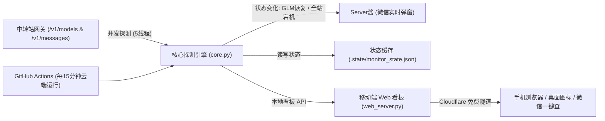

# Relay Monitor — 中转站大模型巡检、手机实时看板与微信自动通知工作流

> **纯 Python 标准库实现 · 零第三方依赖 · 全平台通用（Linux / Windows / macOS）& GitHub Actions 云端托管**

当你使用的 AI 中转站（如 Sub2API / OneAPI / NewAPI 等兼容 Anthropic `/v1/messages` 格式的网关）频繁出现 **智谱 GLM 限流（429）** 或 **上游账号池耗尽（503）** 时，本工作流可以帮助你：
1. **并发测速**：秒级探测中转站全部模型的真实可用性与响应延迟；
2. **手机随时查**：通过自适应移动端 Web 看板（Cloudflare 公网 HTTPS 隧道），4G/5G 流量随时点开查看并一键测速；
3. **微信自动喊你开工**：集成 **Server酱（方糖）** 个人微信推送，模型一恢复（或全线熔断）立即弹窗提醒你手机微信；
4. **傻瓜式向导**：提供 `relay-monitor init` 交互式向导，**自动识别本地 Claude Code 配置**、**手把手引导获取并实测微信 Token**、**自动下载安装内网穿透工具**。

---

## 工作流架构总览



---

## 第 0 步：10 秒获取微信通知 Token（Server酱 SendKey）

本工作流使用免费稳定的 **Server酱·Turbo版** 向你的个人微信发送通知，无需购买服务器或企业微信：

1. 用电脑或手机打开官网：**[https://sct.ftqq.com](https://sct.ftqq.com)**
2. 点击 **「微信扫码登录」**（登录即自动绑定你的微信接收通知）。
3. 登录后点击页面顶部菜单 **「Key & API」**。
4. 复制页面中显示的 **`SendKey`**（格式通常为 `SCT` 开头的一串字母数字，例如 `SCT123456AbCdEf...`）。
5. *(可选确认)* 在顶部 **「消息通道」** 中确认已选中「方糖服务号」或你偏好的微信通道。

> 💡 **提示**：如果你选择下方的 **部署方式一（本地安装）**，安装脚本会自动打开这个网页并现场帮你发一条测试消息验证是否连通！

---

## 部署方式一：本地傻瓜式一键部署（推荐，功能最全）

支持 **本地 CLI 检测 + 手机端公网 Web 看板 + 24 小时守护轮询 + Antigravity 技能集成**。

### 1. 克隆并运行一键安装脚本（Linux / Windows 全平台通用）

**Linux / macOS：**
```bash
git clone https://github.com/asq2w3/relay-monitor.git
cd relay-monitor
./install.sh          # 或 python3 install.py
```

**Windows (PowerShell 或 CMD)：**
```powershell
git clone https://github.com/asq2w3/relay-monitor.git
cd relay-monitor
python install.py     # 或 powershell -ExecutionPolicy Bypass -File install.ps1
```

### 2. 跟着向导一路回车即可

`./install.sh` 会自动安装全局命令 `relay-monitor` 并启动交互式向导（`relay-monitor init`）：
- **自动读取中转站配置**：如果你本机已经配过 Claude Code（`~/.claude/settings.json`），向导会自动提取你的中转站地址和 Token，**直接按回车即可沿用**；
- **微信 SendKey 引导与现场测试**：粘贴刚才拿到的 `SCT...` Key，向导会立刻向你微信发一条测试通知，确认收到才算通过；
- **自动安装 Cloudflare 隧道**：自动为你下载单文件 `cloudflared`（无需账号），生成可在手机 4G/5G 下直接访问的公网 HTTPS 看板链接；
- **可选同步到 GitHub**：如果本机登录了 `gh` CLI，向导还会询问是否顺手帮你把配置写入 GitHub Actions Secrets。

### 3. 启动手机看板与 24h 后台监控

```bash
# 启动后台守护（含 5 分钟自动巡检 + 手机公网看板）
relay-monitor daemon start

# 查看运行状态与当前手机专属链接
relay-monitor daemon status
```

启动后会输出两个专属手机链接：
- **📱 手机 Web 实时看板**：`https://xxxx.trycloudflare.com`
  - 手机浏览器打开后，点击分享栏 **「添加到主屏幕」**，即可像原生 App 一样随时点开看状态、点击 **「🔄 立即重新检测」** 或 **「📲 推送到微信」**。
- **⚡ 微信一键测速链接**：`https://xxxx.trycloudflare.com/api/push`
  - 把这个链接收藏到微信聊天/收藏夹，手机上一点，5 秒内微信服务号直接给你发最新报告！

---

## 部署方式二：GitHub Actions 零服务器云端部署（不用开电脑）

如果你希望**电脑关机后也能在云端自动巡检**，可以直接使用仓库内置的 [`.github/workflows/monitor.yml`](.github/workflows/monitor.yml)：

1. 点击本仓库右上角的 **Fork**，将其 Fork 到你自己的 GitHub 账号下。
2. 进入你 Fork 后的仓库，点击顶部 **Settings** → 左侧 **Secrets and variables** → **Actions** → **New repository secret**，依次添加以下 3 个变量：
   | Name | Value 说明 | 示例 |
   | :--- | :--- | :--- |
   | `RELAY_BASE_URL` | 你的中转站网关地址（末尾不要带斜杠） | `http://1.2.3.4:3060` |
   | `RELAY_TOKEN` | 你的中转站 API Key / Token | `sk-xxxxxxxxxxxx` |
   | `SERVERCHAN_KEY` | 第 0 步获取的 Server酱 SendKey | `SCTxxxxxxxxxxxx` |
3. 点击仓库顶部的 **Actions** 标签页，如果提示工作流默认被禁用，点击绿色按钮 **「I understand my workflows, go ahead and enable them」**。
4. **完成！**
   - **自动定时**：GitHub 会每 15 分钟自动检测一次，并通过 `actions/cache` 记住上次状态——**平时不刷屏，一旦 GLM 恢复或全站宕机才给你发微信**；
   - **手动即时查**：手机上打开 GitHub App 或网页，进入 **Actions → Relay Model Health Monitor → Run workflow**，立刻就能在微信收到完整测速报告！

---

## 常用 CLI 命令速查

```bash
relay-monitor init             # 重新运行交互式向导（修改地址、Token 或更换微信 SendKey）
relay-monitor check            # 终端立即进行一次全量模型并发测速
relay-monitor check --push     # 测速并将完整 Markdown 报告推送到微信
relay-monitor poll-step        # 单步状态变化判定（供定时任务/GitHub Actions 调用）
relay-monitor serve --tunnel   # 前台运行手机 Web 看板与 Cloudflare 隧道
relay-monitor daemon start     # 后台常驻启动（看板 + 隧道 + 5分钟自动巡检）
relay-monitor daemon status    # 查看后台进程状态与手机公网 URL
relay-monitor daemon stop      # 停止后台守护进程
```

---

## 常见问题排查 (FAQ)

1. **为什么 `cloudflared` 隧道偶尔返回 530 或连不上？**
   - 如果你的机器开启了系统代理（如 Clash/Mihomo TUN 模式），UDP/QUIC 流量可能会影响隧道连接。请确保隧道能正常访问外网，或直接运行 `relay-monitor daemon stop && relay-monitor daemon start` 重连生成新域名。
2. **为什么微信一直没收到定时提醒？**
   - 为了避免微信消息轰炸，`poll-step` 与定时守护**仅在状态发生关键跃迁时推送**（例如：GLM 从不可用变为可用 `RECOVERED`，或全站模型突然全部宕机 `ALL_DOWN`）。如需立即强制测试推送，运行 `relay-monitor check --push`。
3. **如何增减特别关注的模型（例如自定义 1M 上下文别名）？**
   - 编辑 `~/.gemini/config/skills/relay-monitor/config.json` 中的 `watch_models` 数组即可（例如 `"glm-5.3-flash[1M]"`）。即使 `/v1/models` 接口没有列出该别名，脚本也会强制将其纳入测速。
